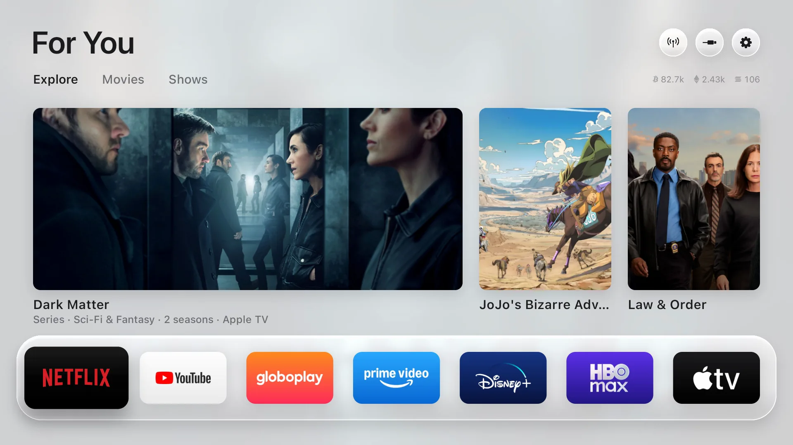
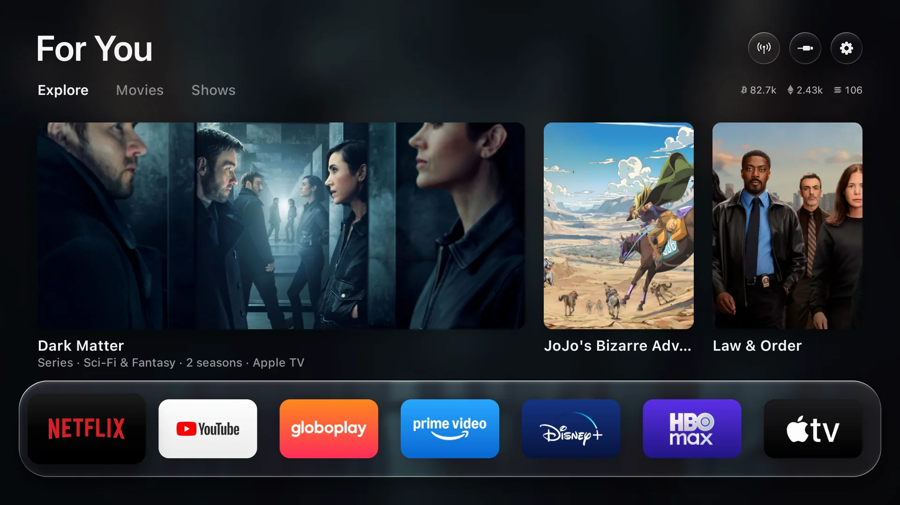

<div align="center">


# FreeMyTV-Android

**Un launcher (pantalla de inicio) rápido y sin anuncios para Android TV y Google TV.**

Basado en [Free My TV](https://github.com/simbasjungles/free-my-tv) de simbasjungles, con cambios propios: no desactiva
nada del sistema, el botón Inicio siempre vuelve al launcher, una pestaña de Stremio, iconos personalizados y más.

 

</div>

## Qué hace

### Lo que trae del Free My TV original

- **Sin anuncios.** Nada de filas patrocinadas, banners ni promociones que se reproducen solas.
- **Tus apps al frente**, en una estantería de vidrio. Eliges cuáles y en qué orden desde la propia tele.
- **Recomendaciones, no publicidad.** Lo que es tendencia esta semana y los estrenos recientes, solo de las apps de
  streaming que tienes instaladas, con pestañas de Explorar, Películas y Series (necesita una clave gratuita de TMDB).
- **Clima y precios a un botón.** Pronóstico por horas o de 5 días, amanecer y atardecer, y precios de criptomonedas.
- **Qué se está reproduciendo**: la música o el podcast que suena de fondo aparece en la pantalla de inicio (opcional).
- **Claro de día, oscuro de noche**, según el atardecer real de tu ciudad, o fijo en claro u oscuro.
- **Salvapantallas a juego**, con fotos a pantalla completa y un reloj grande. También puede mostrar tus propias fotos.
- **Cajón inferior** con TV en vivo, las entradas HDMI (con el nombre del aparato conectado), Todas las apps y los
  ajustes.
- **Temporizador para apagar** la tele, de 5 minutos a 4 horas.
- **Botones de apps del control** (Netflix, YouTube, Prime…) configurables en teles TCL, Sony, Xiaomi, Hisense y otras.
- **Rápido**: 60 fps, dibujado a mano sobre un solo Canvas, sin librerías.
- **Se configura en la tele**: idioma (26, español incluido), ciudad, temperatura, tema, cuántas recomendaciones y de qué
  servicios, el clima, las monedas y las apps de la estantería.

### Lo nuevo en esta versión

- **No desactiva nada.** El original apagaba el launcher de la tele y varias apps del sistema por ADB. Aquí no: Free My
  TV se elige como launcher desde Android, igual que cualquier otro, y el launcher original queda intacto.
- **El botón Inicio siempre lleva a Free My TV.** Con el servicio de accesibilidad activado, Inicio abre Free My TV
  aunque la tele insista en su propio launcher, y si el launcher de la tele aparece (al pulsar Inicio o al salir de una
  app con Atrás), Free My TV vuelve a abrirse encima. Al encender la tele también se abre solo.
- **Pestaña *Seguir viendo* de Stremio**: lo último que viste en Stremio, lo más reciente primero. OK abre el título en
  Stremio, o sigue reproduciendo donde lo dejaste.
- **TV Cable en la estantería**: la app de TV por cable de las placas CVTE (`com.cvte.tv.setting`), con un icono al
  estilo del de Apple TV.
- **Menú de la app con el botón ☰ del control** (o manteniendo OK en *Todas las apps*): poner o quitar de la
  estantería, moverla, **cambiar su icono** por una imagen de la galería, ver la información de la app y
  **desinstalarla** (solo apps de terceros; Android pide confirmar).
- **Foco más visible**: la app seleccionada en la estantería lleva un anillo y su nombre debajo.
- Arreglos de estabilidad: la pantalla ya no se cierra al pulsar Inicio sin recomendaciones configuradas, y el sistema de
  seguridad tras fallos solo cede el botón Inicio 5 minutos en vez de para siempre.

## Instalación

Necesitas una tele o un aparato con Android TV o Google TV (Android 8 o superior) y una computadora en la misma red
Wi‑Fi, con [adb](https://developer.android.com/tools/releases/platform-tools).

1. **En la tele**, activa el modo desarrollador: *Ajustes → Sistema → Información → Compilación* (pulsa 7 veces). Luego
   en *Opciones para desarrolladores* activa la **Depuración USB**. Anota la IP de la tele (*Ajustes → Red*).
2. **Descarga** `FreeMyTV.apk` de la [última versión](../../releases/latest) e instálalo:
   ```bash
   adb connect IP_DE_LA_TELE:5555
   adb install -r FreeMyTV.apk
   ```
   En Android 14, Play Protect puede frenar la instalación («App riesgosa bloqueada»): elige *Más detalles → Instalar
   de todas formas*.
3. **En la tele**, abre *Free My TV → Pantalla de inicio → Free My TV*. Si Android pregunta, elige Free My TV y
   «Siempre».
4. **Botón Inicio**: en la misma pantalla, *Botón Inicio* abre los ajustes de Accesibilidad; activa «Free My TV». O
   desde la computadora:
   ```bash
   adb shell settings put secure enabled_accessibility_services io.freemytv/io.freemytv.RemoteKeyService
   adb shell settings put secure accessibility_enabled 1
   ```
   (Ese comando reemplaza la lista de servicios de accesibilidad: si ya tenías otros, añádelo al final separado por `:`.)

Para volver al launcher de la tele: *Free My TV → Pantalla de inicio → Original*.

## Configuración

Casi todo se cambia en la tele, en *Free My TV → Ajustes de inicio*: idioma, ciudad, tema, temperatura, widgets,
recomendaciones y la clave de TMDB.

- **Clave de TMDB** (para las recomendaciones): gratis en [themoviedb.org](https://www.themoviedb.org/settings/api).
  En *Ajustes de inicio → Clave de TMDB* aparece un código QR para pasarla desde el teléfono, o puedes escribirla con
  el control.
- **Clave de Stremio** (para *Seguir viendo*): se incluye al compilar, en `config.properties` (`stremio_auth_key`).
  Para obtenerla, entra en [web.stremio.com](https://web.stremio.com) con tu cuenta, pulsa F12 → Consola y escribe
  `JSON.parse(localStorage.getItem("profile")).auth.key`. Es privada: da acceso a tu cuenta de Stremio.
- **Ciudad** (clima y modo noche): *Ajustes de inicio → Ciudad*.
- **Tus propias fotos** para el salvapantallas: `python3 tools/photos.py IP_DE_LA_TELE foto.jpg carpeta/`.

[`config.example.properties`](config.example.properties) explica todas las opciones que se pueden fijar al compilar.

## Compilar

Es una app Android en Java, sin Gradle ni librerías: [`build.sh`](build.sh) la compila con el JDK 17 y el Android SDK
(build-tools 34, android-34) y genera `FreeMyTV.apk` (unos 1,5 MB).

```bash
./build.sh            # la primera vez crea config.properties; edítalo y vuelve a ejecutarlo
```

Sin instalar nada: haz un fork, ve a **Actions → Build APK → Run workflow** y descarga `FreeMyTV-apk` de la ejecución.
Si quieres incluir tus claves, guárdalas como secretos del repositorio (`TMDB_KEY`, `STREMIO_AUTH_KEY`) en *Settings →
Secrets and variables → Actions*. No publiques un APK que lleve tus claves dentro.

## Privacidad

Sin cuentas, sin estadísticas, sin rastreo. La app solo se conecta a TMDB (recomendaciones), Open-Meteo (clima),
Binance (precios, si están activados), Stremio (si pones tu clave) y GitHub (al buscar actualizaciones). Tus ajustes se
quedan en la tele.

## Créditos

- **[Free My TV](https://github.com/simbasjungles/free-my-tv)**, de [simbasjungles](https://github.com/simbasjungles) y
  sus colaboradores: el diseño, la pantalla de inicio, las recomendaciones, el salvapantallas y casi todo lo que hace
  este launcher. Esta versión es un fork con las modificaciones descritas arriba.
- La idea del botón Inicio con accesibilidad viene de [LTvLauncher](https://github.com/leanbitlab-org/LtvLauncher).
- Este producto usa la API de TMDB, pero no está respaldado ni certificado por [TMDB](https://www.themoviedb.org/).
- Clima de [Open-Meteo.com](https://open-meteo.com/) (CC BY 4.0). Precios de la API pública de [Binance](https://www.binance.com/).
- Iconos: [Material Symbols](https://fonts.google.com/icons) (Apache 2.0). Fuente: [Inter](https://rsms.me/inter/)
  (SIL OFL 1.1). Logos de monedas: [cryptocurrency-icons](https://github.com/spothq/cryptocurrency-icons) (CC0).
- El codificador de códigos QR sigue el [QR Code generator](https://www.nayuki.io/page/qr-code-generator-library) de
  Project Nayuki (MIT).
- Sin relación con Google, Stremio ni ningún servicio de streaming. Los nombres y logos de las apps son de sus dueños.

## Licencia

[MIT](LICENSE), como el proyecto original.
